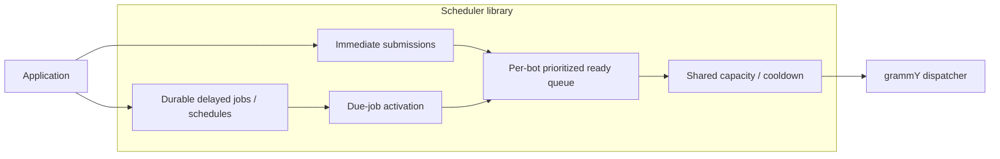

# Outbound queue and scheduler architecture

This document describes the target design: how the scheduler's components fit together. Each active
technical constraint is recorded once in the [decisions folder](decisions/) with its status and
context; this document links to those decisions instead of restating them. The [project
overview](../README.md) describes current capabilities, and the [library
overview](library-overview.md) maps source modules to these components and lists operations that
still reject as unimplemented. [Validation](validation.md) defines acceptance criteria, and [library
research](library-research.md) records supporting dependency findings.

## Scope and ownership

The scheduler queues [outgoing Bot API calls only](decisions/scope-outgoing-bot-api-calls.md).
Immediate, delayed and recurring work for a bot share
[one coordination authority](decisions/scope-one-coordination-authority-per-bot.md).

Clients and workers [borrow caller-owned ioredis connections](decisions/backend-ioredis-driver.md).
Workers also use a [caller-owned grammY API instance](decisions/transport-caller-owned-api.md).

| Component                        | Owns                                                                                                                 |
| -------------------------------- | -------------------------------------------------------------------------------------------------------------------- |
| Client                           | Submit jobs/create schedules, list retained schedule jobs, retrieve status/results, delete schedules                 |
| Core queue/scheduler             | Eligibility, priority ordering, occurrence creation, shared admission, cooldown and retry/recovery decisions         |
| Durable backend                  | Jobs, schedules, bot state, atomic transitions, reservations and recovery records                                    |
| Wakeup/scheduling infrastructure | Trigger due-job activation, cooldown expiry, recurrence and recovery independently of producer lifetime              |
| Telegram executor/transport      | Use grammY to perform an admitted API attempt and report the result; no hidden retry/sleep loop or independent queue |

## Decisions by area

- **Scope:** [outgoing Bot API calls only](decisions/scope-outgoing-bot-api-calls.md),
  [one coordination authority per bot](decisions/scope-one-coordination-authority-per-bot.md).
- **Stack and tooling:**
  [Bun with Node.js and Deno targets](decisions/runtime-bun-primary-node-deno-compatible.md),
  [Bun dependency management](decisions/tooling-bun-dependency-management.md),
  [Zod validation](decisions/tooling-zod-validation.md).
- **Validation:** [trust boundaries](decisions/validation-trust-boundaries.md).
- **Testing:** [opt-in Valkey integration tests](decisions/testing-valkey-integration-opt-in.md).
- **Backend:** [BullMQ backed by Valkey](decisions/backend-bullmq-valkey.md),
  [caller-owned ioredis connections](decisions/backend-ioredis-driver.md),
  [native primitives](decisions/backend-native-primitives.md),
  [logical state records](decisions/backend-logical-state-records.md),
  [single dispatch queue per bot](decisions/backend-single-dispatch-queue.md),
  [bot identity and key namespace](decisions/backend-bot-id-and-key-namespace.md),
  [stored job data](decisions/backend-stored-job-data.md),
  [native terminal outcomes](decisions/backend-native-job-outcomes.md),
  [finished-job retention](decisions/backend-finished-job-retention.md).
- **Public API:**
  [construction without I/O](decisions/api-construction-without-io.md),
  [native BullMQ option types](decisions/api-native-bullmq-option-types.md),
  [job-fetch error reporting](decisions/api-job-fetch-error-reporting.md),
  [internal diagnostics](decisions/api-internal-error-reporting.md),
  [submit options](decisions/api-submit-options.md),
  [durable JSON requests](decisions/api-durable-json-requests.md),
  [bot token handling](decisions/credentials-bot-token-handling.md),
  [visible job states](decisions/api-visible-job-states.md),
  [millisecond timestamps](decisions/time-unix-epoch-milliseconds.md).
- **Admission and 429 handling:**
  [required capabilities](decisions/admission-required-capabilities.md),
  [bot concurrency](decisions/admission-bot-concurrency.md),
  [concurrency set by worker start](decisions/admission-concurrency-set-by-worker-start.md),
  [job priorities](decisions/admission-job-priorities.md),
  [interim urgent rejection](decisions/admission-priority-interim-rejection.md),
  [bot cooldown](decisions/rate-limit-bot-cooldown.md),
  [429 requeue](decisions/rate-limit-native-429-requeue.md),
  [retry delay](decisions/rate-limit-retry-after-fallback.md),
  [interim 429 failure](decisions/rate-limit-interim-429-failure.md).
- **Ordering and recurrence:** [priority and ready-entry FIFO](decisions/ordering-eligible-fifo.md),
  [native interval and UTC cron schedules](decisions/recurrence-native-schedules.md).
- **Outcomes and recovery:**
  [no automatic retransmission](decisions/uncertainty-no-automatic-retransmission.md),
  [stalled-job reporting](decisions/recovery-stalled-replay-disabled.md),
  [outcome classification](decisions/transport-outcome-classification.md),
  [grammY transport](decisions/transport-grammy-outgoing-api.md),
  [caller-owned grammY API](decisions/transport-caller-owned-api.md).

## Job lifecycle

This is the target lifecycle. Priorities, independent due-job activation, cooldowns, 429 requeue and
recurrence are not implemented yet; the [library overview](library-overview.md#current-state)
describes the current behavior.

1. A producer submits a validated request; the backend persists it and guarantees a future
   processing opportunity, after which the producer may exit.
2. Immediate work enters the ready queue; already-created delayed jobs and recurring occurrences
   enter through [due-job activation](decisions/ordering-eligible-fifo.md), independently of dispatch
   capacity and cooldown. Occurrences inherit their schedule's priority.
3. A worker claims ready work in priority order when the bot has capacity and no active cooldown.
4. The dispatcher makes one Telegram attempt and reports a classified outcome.
5. The coordinator settles the job as succeeded or failed, or returns it through
   [native 429 requeue](decisions/rate-limit-native-429-requeue.md), extending the bot's cooldown.

## Durable transitions

The design requires these behaviours, supplied by native engine primitives where possible rather
than behind mandatory adapter method names:

1. **Submit and ensure activation:** persist accepted work and guarantee a future processing
   opportunity.
2. **Claim/reserve:** atomically check eligibility, priority ordering, bot cooldown and capacity; reserve with
   current attempt identity and lease.
3. **Settle/defer/fail:** verify current ownership, save the outcome, release capacity,
   monotonically extend the bot's cooldown and use native retry insertion.
4. **Recover abandoned attempts:** reclaim expired ownership under the
   [no-retransmission policy](decisions/uncertainty-no-automatic-retransmission.md); arrange recovery
   at claim time, not only after successful completion.
5. **Create and advance schedules:** materialize occurrences through the
   [native Job Scheduler](decisions/recurrence-native-schedules.md).
6. **Delete schedule:** use [native scheduler removal](decisions/recurrence-native-schedules.md),
   including removal of the next occurrence if it is still delayed.
7. **Activate due jobs:** move already-created due jobs into the ready queue without requiring a
   free dispatch slot or an expired cooldown; recover pending activation after an interruption.

Duplicate wakeups must reread state and claim before sending; they must not create competing current
claims for one job. Intentional retries and recovery have new attempt identities. Stale workers
cannot overwrite current state, and an old wakeup must not erase a newer one.

## Guarantee limits

Telegram may accept a request before the worker crashes or loses the response, so this library
cannot guarantee exactly-once external effects. Submission deduplication would not solve that
boundary. Ownership and fencing protect stored state but cannot revoke an HTTP request that was
already sent. After lease expiry or failover, physical in-flight requests may exceed the cap on
current reservations.

## Example while dispatch capacity is full

All C slots are occupied. Normal job B enters the ready queue at 12:04, scheduled normal job A
becomes ready at 12:05, and immediate normal job D enters at 12:06. Their ready order is B, A, D;
activation of A does not wait for a dispatch slot. An eligible urgent job can be claimed before
those normal jobs when capacity becomes available, using the same C slots.

A definite 429 at either priority pauses dispatch for the whole bot and uses native retry insertion.
Already-admitted attempts can settle or extend the pause. Due jobs can still enter the ready queue
during the pause, and dispatch resumes after the cooldown.

## Compatibility boundaries

Configuration, payload schema, ordering and failure semantics become migration boundaries once
the library has public consumers or production data. Internal draft interfaces carry no hypothetical
compatibility obligation, while established external contracts and existing data require
preservation or an explicit migration.
