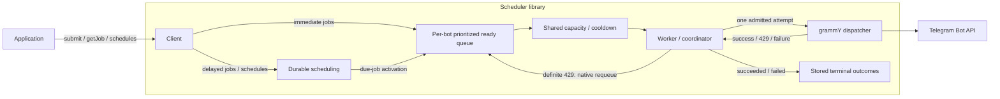

# Library and worker overview

tg-scheduler is a TypeScript library for durable outgoing Telegram calls, accompanied by a
long-lived worker. Applications submit work and retrieve outcomes through the client. Workers
activate due work and execute admitted calls through grammY. BullMQ and Valkey retain work and
coordinate producers and workers for the same bot.

## Current state

The library entry point is [`src/index.ts`](../src/index.ts). The client and worker implement the
basic delivery path for immediate and one-time delayed jobs. Client and worker factories validate
their options at construction, which performs no I/O. The client initializes BullMQ on first use;
the worker initializes it in `start()`. Connections are
[created and owned by the caller](decisions/backend-ioredis-driver.md).

A definite 429 currently [settles the job as `failed`](decisions/rate-limit-interim-429-failure.md),
because the bot cooldown is not implemented.
Schedules, urgent-priority requests, and the coordinator's recovery function reject with
`UnimplementedError`. Priority selection and due-job activation independent of dispatch capacity
are not implemented yet; delayed promotion currently runs through BullMQ worker fetching.

## Intended flow

The arrows describe the intended integration; BullMQ and Valkey persist the queues and scheduling
state. Admission currently relies on BullMQ's queue-wide concurrency; priorities, independent
activation, cooldowns, recurrence, and recovery records are not connected yet.
The producer may exit after acceptance; the operated worker supplies future execution opportunities.
All participants for one bot must use the same backend namespace and stable bot identity.

## Source map

| Module                                                                          | Responsibility                                                                                          |
| ------------------------------------------------------------------------------- | ------------------------------------------------------------------------------------------------------- |
| [`src/index.ts`](../src/index.ts)                                               | Public library exports; importing them performs no startup or environment access.                       |
| [`src/client.ts`](../src/client.ts)                                             | Producer configuration, submission, job retrieval, schedule creation/disable, and connection cleanup.   |
| [`src/worker.ts`](../src/worker.ts)                                             | Worker configuration and lifecycle, including shared per-bot policy and token resolution.               |
| [`src/shared-bot-options.ts`](../src/shared-bot-options.ts)                     | Bot identity, caller-owned connections, and the queue namespace used by clients and workers.            |
| [`src/jobs.ts`](../src/jobs.ts)                                                 | Job handles, earliest execution time, delivery lane, visible job outcomes, and settled outcomes.        |
| [`src/schedules.ts`](../src/schedules.ts)                                       | Schedule handles, fixed intervals, and planned-time anchors.                                            |
| [`src/telegram.ts`](../src/telegram.ts)                                         | grammY-derived method, payload, and result types, and durable JSON request validation at submission.    |
| [`src/core/coordinator.ts`](../src/core/coordinator.ts)                         | Admission, ordering, cooldowns, outcome settlement, and abandoned-attempt recovery.                     |
| [`src/backend/bullmq.ts`](../src/backend/bullmq.ts)                             | Queue identity, caller-owned connections, shared capacity, and BullMQ resource cleanup.                 |
| [`src/backend/stored-job.ts`](../src/backend/stored-job.ts)                     | Stored job data and outcomes, enqueueing, and mapping BullMQ job states to job snapshots.               |
| [`src/transport/telegram-transport.ts`](../src/transport/telegram-transport.ts) | Transport interface used by the coordinator: one attempt, its classified outcome, and token resolution. |
| [`src/transport/grammy.ts`](../src/transport/grammy.ts)                         | grammY implementation of the transport, without an automatic retry layer.                               |
| [`src/error-handler.ts`](../src/error-handler.ts)                               | Reporting for asynchronous errors that no operation awaits.                                             |
| [`src/unimplemented-error.ts`](../src/unimplemented-error.ts)                   | Explicit failure for unfinished operations.                                                             |

These are modules within the selected BullMQ implementation. Storage transitions and native worker
wiring remain provisional until selected-version integration establishes the required semantics.
Environment access, runtime permissions, process signals, and process exit
[belong in executables](decisions/runtime-bun-primary-node-deno-compatible.md).

## Consumer API

[`examples/library.ts`](../examples/library.ts) is a type-checked usage sketch. It shows immediate
submission, delayed submission using `runAtMs`, fixed-interval schedules, result retrieval, disabling
recurrence, and worker configuration. It has no top-level execution; its schedule calls reject
until recurrence is implemented.

- `submit(method, payload, options?)` returns a durable job handle after acceptance.
- `getJob(jobId)` retrieves a stored snapshot or `undefined` when the job does not exist.
- `createSchedule(method, payload, options)` is scaffolded for fixed-interval recurrence and currently
  rejects as unimplemented.
- `disableSchedule(scheduleId)` stops future occurrences while preserving accepted jobs.
- `client.close()` releases its BullMQ resources while leaving the supplied connection open;
  later operations reject.
- `worker.start()` begins due-work activation; `worker.close()` stops admission, drains active
  work, and releases its resources.

Public payload and result types come from grammY. The Telegram Bot API lifecycle methods `logOut`
and `close` remain part of the method surface; update polling and webhook management are excluded.
Submission accepts only [durable JSON requests](decisions/api-durable-json-requests.md), which
include file IDs but not new uploads. A job snapshot pairs each method with its result type:
checking `state === 'succeeded'` and `method === 'sendMessage'` exposes the returned message's
fields.

Job states and their meanings are defined in [visible job
states](decisions/api-visible-job-states.md). A worker that stops mid-attempt leaves its job
`in-flight`, then `queued`, until a running worker [records it as
`failed`](decisions/recovery-stalled-replay-disabled.md), so `queued` does not prove that a
request was never sent. Clients and workers report asynchronous
errors that no operation awaits [to `onError`](decisions/api-unawaited-error-reporting.md).

## Coordination contract

Workers configure [shared concurrency for their bot](decisions/admission-concurrency-set-by-worker-start.md)
during startup. The current scaffold still names the capacity option `ordinaryConcurrency`, the
submission selector `lane`, and a rejected worker placeholder `urgentBypassEnabled`; these do not
implement the selected [job priorities](decisions/admission-job-priorities.md).
Priorities, independent activation, the bot cooldown, 429 requeue, recurrence and recovery records
are not implemented yet. The
[architecture](architecture.md#decisions-by-area) links the decisions that define them, and
[validation](validation.md) defines the evidence needed to claim they work.
