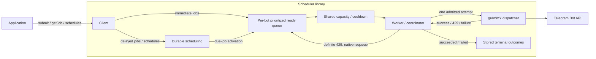

# Library and worker overview

tg-scheduler is a TypeScript library for durable outgoing Telegram calls. Applications submit work
and retrieve outcomes through the client, and run library workers to activate due work and execute
admitted calls through grammY. BullMQ and Valkey retain work and coordinate clients and workers for
the same bot.

## Current state

The library entry point is [`src/index.ts`](../src/index.ts). The client and worker implement the
basic delivery path for immediate and one-time delayed jobs. Client and worker factories validate
their options at construction, which performs no I/O. The client initializes BullMQ on first use;
the worker initializes it in `start()`. Connections are
[created and owned by the caller](decisions/backend-ioredis-driver.md).

Workers use a [caller-owned grammY API instance](decisions/transport-caller-owned-api.md), and
grammY is a peer dependency.

Client queue connection errors between operations are logged with `console.warn`; unexpected
processing errors and other unawaited worker faults are logged with `console.error`, following
[internal diagnostics](decisions/api-internal-error-reporting.md). The optional
[`onJobFetchError` handler](decisions/api-job-fetch-error-reporting.md) is not implemented yet:
BullMQ reports next-job retrieval failures through the same worker `error` event as other faults,
so they currently reach `console.error`.

A definite 429 currently [settles the job as `failed`](decisions/rate-limit-interim-429-failure.md),
because the bot cooldown is not implemented.
Schedule creation, deletion and job listing, and urgent-priority requests, reject with
`UnimplementedError`.
Priority selection and due-job activation independent of dispatch capacity are not implemented
yet; delayed promotion currently runs through BullMQ worker fetching.

## Intended flow

The arrows describe the intended integration; BullMQ and Valkey persist the queues and scheduling
state. Admission currently relies on BullMQ's queue-wide concurrency; priorities, independent
activation, cooldowns, recurrence, and recovery records are not connected yet.
Clients and workers can run in the same application process or in separate application instances.
A library worker can process queued requests without a grammY `Bot` or an inbound update handler.
The submitting process may exit after acceptance; running library workers provide future execution
opportunities.
All participants for one bot must use the same backend namespace and stable bot identity.

## Source map

| Module                                                                          | Responsibility                                                                                         |
| ------------------------------------------------------------------------------- | ------------------------------------------------------------------------------------------------------ |
| [`src/index.ts`](../src/index.ts)                                               | Public library exports; importing them performs no startup or environment access.                      |
| [`src/client.ts`](../src/client.ts)                                             | Producer configuration, submission, job retrieval, schedule creation/deletion, and connection cleanup. |
| [`src/worker.ts`](../src/worker.ts)                                             | Worker configuration and lifecycle, including shared per-bot policy and the caller's grammY API.       |
| [`src/shared-bot-options.ts`](../src/shared-bot-options.ts)                     | Bot identity, caller-owned connections, and the queue namespace used by clients and workers.           |
| [`src/jobs.ts`](../src/jobs.ts)                                                 | Job handles, earliest execution time, job priority, visible job outcomes, and settled outcomes.        |
| [`src/schedules.ts`](../src/schedules.ts)                                       | Schedule handles, priority, and the BullMQ-typed interval and UTC cron recurrence forms.               |
| [`src/telegram.ts`](../src/telegram.ts)                                         | grammY-derived method, payload, and result types, and durable JSON request validation at submission.   |
| [`src/core/coordinator.ts`](../src/core/coordinator.ts)                         | Bot policy and settlement of one claimed job; cooldowns and 429 requeue belong here.                   |
| [`src/backend/bullmq.ts`](../src/backend/bullmq.ts)                             | Queue identity, caller-owned connections, shared capacity, and BullMQ resource cleanup.                |
| [`src/backend/stored-job.ts`](../src/backend/stored-job.ts)                     | Stored job data and outcomes, enqueueing, and mapping BullMQ job states to job snapshots.              |
| [`src/transport/telegram-transport.ts`](../src/transport/telegram-transport.ts) | Transport interface used by the coordinator: one attempt and its classified outcome.                   |
| [`src/transport/grammy.ts`](../src/transport/grammy.ts)                         | Transport over the caller's grammY API instance, without an automatic retry layer.                     |
| [`src/diagnostics.ts`](../src/diagnostics.ts)                                   | Local console diagnostics for errors that no operation awaits.                                         |
| [`src/unimplemented-error.ts`](../src/unimplemented-error.ts)                   | Explicit failure for unfinished operations.                                                            |

These are modules within the selected BullMQ implementation. Storage transitions and native worker
wiring remain provisional until selected-version integration establishes the required semantics.
Environment access, runtime permissions, process signals, and process exit
[belong to the host application](decisions/runtime-bun-primary-node-deno-compatible.md).

## Consumer API

[`examples/library.ts`](../examples/library.ts) is a type-checked usage sketch. It shows immediate
submission, delayed submission using `runAtMs`, native interval and UTC cron schedules, result
retrieval, schedule deletion, and worker configuration. It has no top-level execution; its schedule
calls reject until recurrence is implemented.

- `submit(method, payload, options?)` returns a durable job handle after acceptance.
- `getJob(jobId)` retrieves a stored snapshot or `undefined` when the job does not exist.
- `createSchedule(method, payload, recurrence, options?)` accepts one native recurrence form,
  typed from BullMQ's `RepeatOptions`: `{ every: milliseconds }` or `{ pattern: cronExpression }`.
  `options.priority` sets the priority inherited by occurrences. It currently rejects as
  unimplemented. The [recurrence contract](decisions/recurrence-native-schedules.md) defines
  initial eligibility and UTC cron evaluation.
- `deleteSchedule(scheduleId)` is scaffolded and currently rejects as unimplemented. It will remove
  the definition and its next occurrence if still delayed, while preserving ready, in-flight and
  finished jobs. See
  [native scheduler removal](decisions/recurrence-native-schedules.md) for the removal boundary
  and races with activation.
- `listScheduleJobs(scheduleId)` is scaffolded and currently rejects as unimplemented. It will
  return handles for the schedule's retained jobs, including after deletion of the schedule
  definition; pass a listed ID to `getJob` for its current state and outcome. See the
  [listing contract](decisions/recurrence-native-schedules.md).
- `client.close()` releases its BullMQ resources while leaving the supplied connection open;
  later operations reject.
- `worker.start()` begins due-work activation; `worker.close()` stops admission, drains active
  work, and releases its resources.

Public payload and result types come from grammY. The Telegram Bot API lifecycle methods `logOut`
and `close` remain part of the method surface; update polling and webhook management are excluded.
Submission accepts only [durable JSON requests](decisions/api-durable-json-requests.md), which
include file IDs but not new uploads. A job snapshot pairs each method with its result type:
checking `state === 'succeeded'` and `method === 'sendMessage'` exposes the returned message's
fields.

Job IDs are opaque strings. Snapshots expose `scheduledForMs` through the
[native timing contract](decisions/backend-stored-job-data.md); immediate work, including a past
`runAtMs`, reports enqueue time. Future one-time jobs and recurring occurrences report their
initial scheduled time, which remains available after execution.

Job states and their meanings are defined in [visible job
states](decisions/api-visible-job-states.md). A worker that stops mid-attempt leaves its job
`in-flight`, then `queued`, until a running worker [records it as
`failed`](decisions/recovery-stalled-replay-disabled.md), so `queued` does not prove that a
request was never sent.

## Coordination contract

Workers configure [shared concurrency for their bot](decisions/admission-concurrency-set-by-worker-start.md)
during startup through `policy.dispatchConcurrency`. Submissions and schedules select a
[job priority](decisions/admission-job-priorities.md); urgent work
[rejects until priorities are implemented](decisions/admission-priority-interim-rejection.md).
Priorities, independent activation, the bot cooldown, 429 requeue, recurrence and recovery records
are not implemented yet. The
[architecture](architecture.md#decisions-by-area) links the decisions that define them, and
[validation](validation.md) defines the evidence needed to claim they work.
