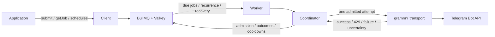

# Library and worker overview

tg-scheduler is a TypeScript library for durable outgoing Telegram calls, accompanied by a
long-lived worker. Applications submit work and retrieve outcomes through the client. Workers
activate due work and execute admitted calls through grammY. BullMQ and Valkey retain work and
coordinate producers and workers for the same bot.

## Current state

The library entry point is [`src/index.ts`](../src/index.ts). Its API and internal modules are a
compiling skeleton: client, worker, and transport factories construct objects without opening
connections, resolving tokens, or making Telegram calls. Their methods, including `close()`,
reject with `UnimplementedError`. Backend opening and coordinator functions also reject explicitly.
Options and payloads are typed but runtime validation is still pending, except for the Valkey URL,
which the backend's connection factory validates. That factory is the implemented part of the
backend; nothing runnable uses the skeleton yet.

## Intended flow

The arrows describe the intended integration. The skeleton does not connect these components yet.
The producer may exit after acceptance; the operated worker supplies future execution opportunities.
All participants for one bot must use the same backend namespace and stable bot identity.

## Source map

| Module                                                                    | Responsibility                                                                                           |
| ------------------------------------------------------------------------- | -------------------------------------------------------------------------------------------------------- |
| [`src/index.ts`](../src/index.ts)                                         | Public library exports; importing them performs no startup or environment access.                        |
| [`src/client.ts`](../src/client.ts)                                       | Producer configuration, submission, job retrieval, schedule creation/disable, and connection cleanup.    |
| [`src/jobs.ts`](../src/jobs.ts)                                           | Job handles, earliest execution time, delivery lane, and visible job outcomes.                           |
| [`src/schedules.ts`](../src/schedules.ts)                                 | Schedule handles, fixed intervals, and planned-time anchors.                                             |
| [`src/telegram.ts`](../src/telegram.ts)                                   | grammY-derived method, payload, and result types, excluding new file uploads and inbound operations.     |
| [`src/worker.ts`](../src/worker.ts)                                       | Worker configuration and lifecycle, including shared per-bot policy and token resolution.                |
| [`src/core/coordinator.ts`](../src/core/coordinator.ts)                   | Admission, ordering, cooldowns, outcome settlement, occurrence creation, and abandoned-attempt recovery. |
| [`src/backend/bullmq.ts`](../src/backend/bullmq.ts)                       | Concrete per-bot BullMQ queues, Valkey persistence, and owned connection lifecycle.                      |
| [`src/backend/valkey-connection.ts`](../src/backend/valkey-connection.ts) | Valkey URL validation and producer/worker connection settings for injected BullMQ clients.               |
| [`src/transport/grammy.ts`](../src/transport/grammy.ts)                   | One outgoing attempt, worker-side credential resolution, and a classified transport outcome.             |
| [`src/unimplemented-error.ts`](../src/unimplemented-error.ts)             | Explicit failure for unfinished operations.                                                              |

These are modules within the selected BullMQ implementation. Storage transitions and native worker
wiring remain provisional until selected-version integration establishes the required semantics.
Environment access, runtime permissions, process signals, and process exit belong in executables.

## Consumer API

[`examples/library.ts`](../examples/library.ts) is a type-checked usage sketch. It shows immediate
submission, delayed submission using `runAtMs`, fixed-interval schedules, result retrieval, disabling
recurrence, and worker configuration. It has no top-level execution and is not a working delivery
example yet.

- `submit(method, payload, options?)` returns a durable job handle after acceptance.
- `getJob(jobId)` retrieves a stored snapshot or `undefined` when the job does not exist.
- `createSchedule(method, payload, options)` returns a handle for an ordinary-lane recurring schedule.
- `disableSchedule(scheduleId)` stops future occurrences while preserving accepted jobs.
- `client.close()` releases a client's owned backend resources.
- `worker.start()` begins due-work activation; `worker.close()` stops admission, drains active
  work, and releases its resources.

Public payload and result types come from grammY. The Telegram Bot API lifecycle methods `logOut`
and `close` remain part of the method surface; update polling and webhook management are excluded.
File IDs remain supported string references; `InputFile` uploads are excluded from payload types.
Submission must eventually validate durable
JSON at runtime as well. A job snapshot pairs each method with its result type: checking
`state === 'succeeded'` and `method === 'sendMessage'` exposes the returned message's fields.

Job states are `queued`, `in-flight`, `succeeded`, `failed`, and `uncertain`. Unknown external outcomes
remain visible as uncertain, without automatic retransmission. A definite 429 keeps the job queued
for durable retry after the relevant cooldown.

## Coordination contract

Ordinary concurrency defaults to one and is shared across workers for a bot. Urgent bypass defaults
to disabled; when enabled it adds one slot, restricted to callback and pre-checkout answers. Each
lane owns a separate cooldown that can only extend. Eligible ordinary jobs retain their original
due-time and submission rank across 429 retries.

All application timestamps use Unix epoch milliseconds; durations use milliseconds. The transport
reports Telegram's external `retry_after` value in seconds for the coordinator to validate and
convert once. Missing or invalid delays use the selected thirty-second fallback.

Recurrence stays anchored to planned times. After downtime, missed occurrences that were never
materialized coalesce to the latest one. Already accepted jobs remain intact, including when their
schedule is disabled. Recovery fences stale attempts and preserves uncertainty instead of silently
replaying ambiguous sends.

These behaviors remain unimplemented. The [architecture](architecture.md) defines their full
semantics, and [validation](validation.md) defines the evidence needed to claim they work. Bun is
the primary runtime; Node.js and Deno remain library compatibility targets. Skeleton imports and
type checking do not establish durable scheduler behavior on any runtime.
